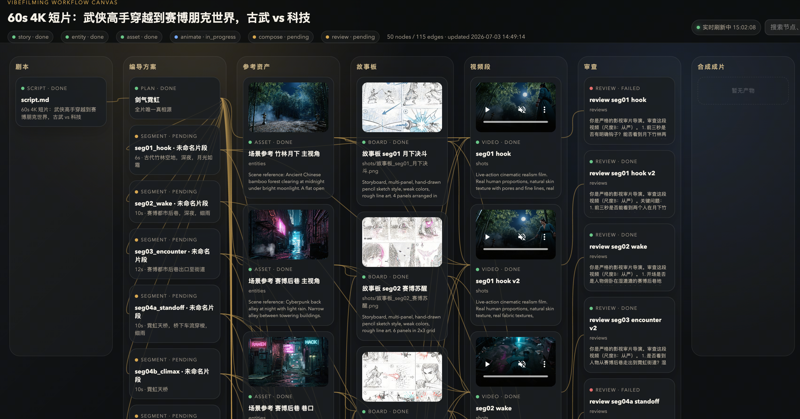
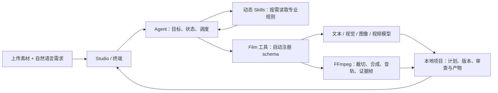

<div align="center">

# 🎬 VibeFilming

### 上传一条参考片，说清要改什么，让 AI 接手导演工作。

**保留钩子与节奏 · 替换指定变量 · 拆镜、生成、审片、合成一路可见**

An open-source AI director for reference-driven video remakes.

[](https://github.com/wangzai-double-milk/Vibefilming/stargazers)
[](./LICENSE)


[快速开始](#快速开始) · [最新更新](#最新更新) · [使用示例](./demo.md) · [Skills 扩展](./SKILLS_ARCHITECTURE.md) · [交流群](#交流群)

</div>

---

> **「把这条游戏广告的背景换成冰雪世界。人物、玩法、切点、HUD 和原音轨全部保留，完整做完。」**

这句话就是任务入口。上传母片后，VibeFilming 把需求展开成项目规范，理解完整时间轴，
规划受影响镜头、准备动作故事板、调用模型、检查结果，再合成并交付新版本。
你可以在关键步骤确认，也可以选择端到端推进。

适合游戏买量素材裂变、产品广告、IP 展示、短片与预告制作。复刻默认保留原片的媒介、
动作因果和节奏；自由创作则按你明确授权的范围展开。

**参考视频 + 一句需求 → 可追溯的 MP4 与制作证据。**

## 最新更新

**2026.10 · 从单次视频生成，走向完整母片复刻与可扩展的导演 Agent。**

| 更新 | 带来的变化 |
|---|---|
| 🧩 **9 个独立 Skills，动态发现** | 拆镜、剧本、编导、故事板、提示词、审片等职责解耦。新增 `SKILL.md` 自动进入索引，无需改系统提示词或其他 Skill。 |
| 🎞️ **完整母片时间轴** | 标记每段是否受目标变量影响；只生成受影响内容，其余复用。按源片切点与时长回装，避免把代表段当整片交付。 |
| 🎯 **单变量修改合同** | 明确“允许改变、必须保持、最小因果适配”。换人物、换环境或换玩法时，未授权内容继续锁定。 |
| ✏️ **动作故事板真实参与生成** | 简笔画配运动箭头，记录动作、接触与状态变化；动态生成单元必须把故事板作为实际参考传入。 |
| 🎥 **Seedance 2.0 / 2.5 项目级选型** | Studio 可切换模型；参考数量、时长、格式及 edit / extend 等策略按当前模型能力校验。 |
| 📋 **项目规范随任务保存** | 世界观、资源名、UI 术语和禁止项写入项目，在拆镜、计划、生成和审片中持续使用。 |
| 🔁 **稳定单元与任务恢复** | 保存逻辑单元、提交次数与 task ID。查询、下载失败复用原任务；未知提交状态阻止重复生成。 |
| 🖥️ **Git 本地版独立运行** | Agent、Studio、媒体处理与项目交付均使用本地约定；无需 MA 会话路径。TOS 可选，产物直接在本地查看和下载。 |

本轮整理验证通过 **75 项离线回归**，覆盖动态路由、执行模式、裂变约束、接缝、
多模态限制、模型选择和存储一致性。离线回归验证软件行为，成片质量仍需按实际任务审查。

## 看得见的制作过程

Studio 把对话、项目管理、素材上传与实时工作流放在一起。剧本、计划、参考图、
故事板、视频段与审查结果随制作进度更新，可以随时查看当前卡在哪一步。



这张图展示工作流可视化；当前界面以仓库运行结果为准。
想看从需求到成片、再到对话改片的制作记录，打开[使用示例](./demo.md)。

## 给它一个明确的修改目标

| 场景 | 可以这样说 |
|---|---|
| 换背景 | “背景改成冰雪环境，保留人物、玩法、动作、镜头、HUD 和原音轨，完整复刻。” |
| 换游戏角色 | “只换成我上传的角色设计，保持原游戏画风、背景、事件、切点和数字时机。” |
| 换核心玩法 | “非真人游戏段改成磁力打捞物资 → 净水处理 → 水上基地升级，其他内容保持。” |
| 产品广告 | “用这张冷萃咖啡产品图做一条 15 秒竖屏广告，先让我确认剧本。” |
| 自由创作 | “做一条 30 秒雨夜武侠预告，自由创作剧情，镜头节奏快、动作接触清楚。” |
| 局部修改 | “第二镜反馈太慢，压缩等待，保留接触动作，其他镜头沿用当前版本。” |

完整复刻任务锁定源片顺序、切点、画幅、字幕/HUD 时机与原音轨；
目标时长误差不超过一帧。源片中的可识别真人或疑似真人段按当前制作规则直接复用，
不送入人物参考或生成链路。不同变体从同一母片独立派生。

“高节奏”落实为压缩移动与等待、提高有效反馈频率，动作的接触与因果仍要成立。
代表段可以验证方案，整片成功必须有完整时间轴和终审证据。

## 快速开始

需要 **Python 3.10–3.13**，推荐 3.12；支持 macOS / Linux，Windows 建议使用 WSL2。
模型请求需要火山方舟 API Key，以及所选模型的访问权限。

```bash
git clone https://github.com/wangzai-double-milk/Vibefilming.git
cd Vibefilming
bash setup.sh
```

安装脚本会创建 `.venv`、安装依赖，并生成 `vibefilming.config.json`。
打开配置填入 `ark.api_key`，保留模板中的模型字段，然后启动：

```bash
.venv/bin/python agentmain.py --open-studio
```

默认 Studio：**http://127.0.0.1:8764/**。
上传素材、选择执行模式与视频模型，再输入需求即可。画布服务默认使用端口 8765；
实际地址以终端输出为准。

| 启动方式 | 命令 |
|---|---|
| 终端 + Studio | `.venv/bin/python agentmain.py` |
| 自动打开网页 | `.venv/bin/python agentmain.py --open-studio` |
| 仅终端 | `.venv/bin/python agentmain.py --no-studio` |
| 修改 Studio 端口 | `.venv/bin/python agentmain.py --studio-port 8770` |

安装排障、远程监听与完整参数见 [SETUP.md](./SETUP.md)。

### 模型与配置

| 能力 | 配置 | 用途 |
|---|---|---|
| 文本推理 | `ark.models.text` | 理解需求、编剧、规划与调度 |
| 多模态理解 | `ark.models.vlm` | 视频拆镜、参考理解与视觉审查 |
| Seedream | `ark.models.image` | 角色、场景、产品与故事板参考 |
| Seedance | `video_2_0` / `video_2_5` | 视频生成、多模态参考及受支持的视频编辑策略 |
| BigMusic，可选 | `volc.ak` / `volc.sk` | 按计划生成 BGM |

模板已配置 Seedance 2.0 与 2.5，`ark.models.video` 指定默认模型。
只配置一个视频模型时使用该模型；同时配置时可在 Studio 按项目选择。
具体模型 ID、访问权限和能力以当前配置及提供方接口为准。

本地查看与交付无需 TOS。方舟 Files 可用于模型参考传输：
Seedance 视频输入需要有效 URL 或 `asset://` 引用，本地路径不能直接当 `video_url`；
执行器可发布私有参考并保存 sidecar。API 调用费用由模型提供方收取。

### 两种推进方式

| 模式 | 适合谁 | 行为 |
|---|---|---|
| `human_gated`，默认 | 希望先确认方向 | 拆镜完成和剧本定稿后等待确认 |
| `autonomous` | 希望自动全流程推进 | 机器校验通过后继续；遇到真实阻塞则交付现有证据 |

模式可以在 Studio 切换。两种模式采用相同的制作与验收标准。
世界观、资源名、画风、固定 UI 和禁止修改项可以写进项目规范，随项目持久保存。

## 一支可扩展的 AI 导演团队



系统提示词维护入口、变更边界和运行原则；专业经验分散到独立 Skill；
执行工具负责参数校验、模型请求与文件落盘。任务可以因审片反馈回到某个受影响环节，
已确认的素材和镜头继续复用。

| Skill | 职责 |
|---|---|
| [拆镜](./skills/skill_breakdown/SKILL.md) | 理解母片、记录时间轴与观察事实 |
| [制作总控](./skills/skill_movie/SKILL.md) | 阶段编排、执行模式、恢复与交付 |
| [剧本](./skills/skill_script/SKILL.md) | 正式剧情、动作因果与声音内容 |
| [编导](./skills/skill_director/SKILL.md) | 镜头职责、节拍、参考与生成策略 |
| [动作故事板](./skills/skill_storyboard/SKILL.md) | 简笔画、运动箭头与关键状态 |
| [提示词工程](./skills/skill_prompt_engineering/SKILL.md) | 把计划转换为可执行的模型要求 |
| [制作审查](./skills/skill_review/SKILL.md) | 判断缺陷、定位根因与最小修复 |
| [广告](./skills/skill_ad/SKILL.md) | 产品卖点、证据与广告表达 |
| [小红书美食视频](./skills/skill_xhs_food_video/SKILL.md) | 对应内容场景的专业创作规则 |

### 新增能力，只从自己的 Skill 开始

新建 `skills/my_feature/SKILL.md`：

```markdown
---
name: my-feature
description: 当用户需要这项新能力时使用。负责输出明确的独立产物。
---

# 我的新能力

写清输入、判断规则、产物合同与验收标准。
```

下一次任务自动发现，无需改系统提示词或现有 Skill。
Skill 不互相点名调用，通过中立产物合同协作；较长的经验放在 `references/` 按需读取。
独立脚本还可声明包内 `entrypoint` 和 `requirements`，路径会经过校验。

新增原生 Film 工具使用 `@film_tool`，自动生成 schema 并挂载到 Agent。
详细规范见 [SKILLS_ARCHITECTURE.md](./SKILLS_ARCHITECTURE.md)
与 [添加工具](./film/ADDING_TOOLS.md)。

## 成片与证据，都留在项目里

```text
projects/<project_id>/
├── manifest.json         项目规范、模型、阶段、素材与预算
├── script.md             正式剧本
├── director_plan.json    编导计划与所选版本
├── materials/            用户素材、拆镜表与来源观察稿
├── entities/             角色、场景、产品与道具参考
├── shots/                故事板、关键帧与生成视频段
├── audios/               音频素材
├── composed/             合成版本与时间轴
├── reviews/              审查结论、联系表与接缝证据
└── logs/                 工具调用、模型任务与资产引用
```

根目录可通过 `VIBEFILMING_PROJECTS_ROOT` 设置，文件名以实际计划和工具返回为准。
完整母片复刻还要求保存 `full_timeline.json`、`generation_units.json`、
`review_final.json` 和 `delivery_manifest.json`，记录复用/生成范围、故事板绑定、
模型任务、所选成片与残留问题。

**可播放性、制作合同、业务验收和投放效果分别报告。**
只有完整证据支持时才标为 `passed`，受阻或未完成如实标为 `blocked` / `partial`。
项目名称里的“爆款”描述应用场景，实际转化效果需要投放数据验证。

## 验证与常见问题

开发时可以运行本轮采用的离线回归，涵盖软件流程与媒体约束：

```bash
.venv/bin/python -m pip install "pillow>=9.0"
.venv/bin/python -m unittest \
  smoke_tests.test_21_studio_and_skill_routing \
  smoke_tests.test_26_execution_modes \
  smoke_tests.test_27_fission_regressions \
  smoke_tests.test_30_transition_seams \
  smoke_tests.test_31_seedance_multimodal_limits \
  smoke_tests.test_32_remake_spec \
  smoke_tests.test_33_seedance_model_routing \
  smoke_tests.test_34_storage_snapshot_atomicity
```

其他模型 smoke tests 可能调用真实 API 并产生费用，运行前检查配置与测试内容。

<details>
<summary><b>视频生成很久没有返回，怎么办？</b></summary>

使用原 task ID 查询并收取结果。轮询超时只表示这次等待结束，不代表提交失败；
不要为恢复下载重复提交。未知提交结果由生成单元状态门禁阻止盲目重试。

</details>

<details>
<summary><b>换人、换景，能保证每帧完全不变吗？</b></summary>

制作合同锁定未授权的内容，并通过参考、计划与审查约束模型结果。
生成模型仍可能产生漂移，出现缺陷会如实记录。严格运动继承需要对应原片
真实参与视频参考；仅有静态图时不能承诺原运动逐帧复现。

</details>

<details>
<summary><b>能在服务器运行吗？</b></summary>

可以。Studio 和 Canvas 默认只监听 `127.0.0.1`。远程部署的监听、
代理与显式开关见 [SETUP.md](./SETUP.md)，公开访问需自行建立身份边界。

</details>

<details>
<summary><b>这个仓库和 MA 版是什么关系？</b></summary>

本仓库维护 Git 本地版，使用本地 Agent、Studio 与项目文件。
MA 版采用托管沙箱和 Session Files，并独立维护部署入口。
两版沿用同类业务 Skills 与产物合同，本仓库不携带 MA 部署包或会话路径依赖。

</details>

## 文档与贡献

- [导演使用手册](./DIRECTOR_GUIDE.md)：如何表达需求、复刻和改片。
- [启动与配置](./SETUP.md)：安装、模型、执行模式与服务器参数。
- [Skills 架构](./SKILLS_ARCHITECTURE.md)：动态发现、独立扩展与产物合同。
- [飞书机器人](./docs/SETUP_FEISHU.md)：可选的对话入口。
- [制作示例](./demo.md)：从需求到成片的记录。

欢迎带着具体问题提 [Issue](https://github.com/wangzai-double-milk/Vibefilming/issues)，
或通过 PR 贡献独立 Skill、工具、失败案例与修复。
描述问题时提供修改目标、受影响时间段、实际偏差与必要日志；提交前移除 API Key、
私有参考链接和未经授权公开的素材。

## 交流群

加入飞书或微信交流群，交流制作经验、反馈问题：

| 飞书 | 微信 |
|---|---|
|  |  |

---

<div align="center">

**让一句需求，成为一条有依据、能修改、可交付的视频。**

如果 VibeFilming 对你有帮助，欢迎 ⭐ Star，也欢迎带着作品和问题一起改进。

MIT License · [wangzai-double-milk/Vibefilming](https://github.com/wangzai-double-milk/Vibefilming)

</div>
